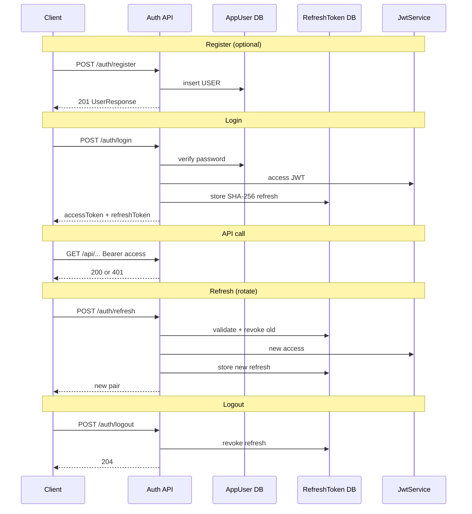

# Diagram: Auth flow

> **Living diagram** — update when login/refresh/register/user APIs change.

## Demo vs product

| Mode | Users |
|------|-------|
| Local seed on | admin/user seeded |
| Register on | Self-service USER |
| Admin | POST /users with roles |
| Prod default | seed off, register off — provision deliberately |
