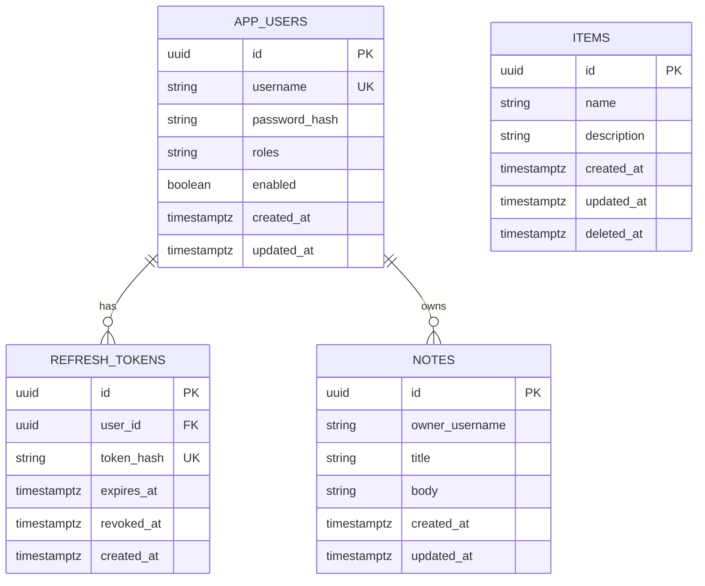

# Diagram: Data model

> **Living diagram** — update with every Flyway migration.

## Migrations

| Version | File |
|---------|------|
| V1 | `V1__create_items.sql` |
| V2 | `V2__create_users_and_refresh_tokens.sql` |
| V3 | `V3__create_notes.sql` |
