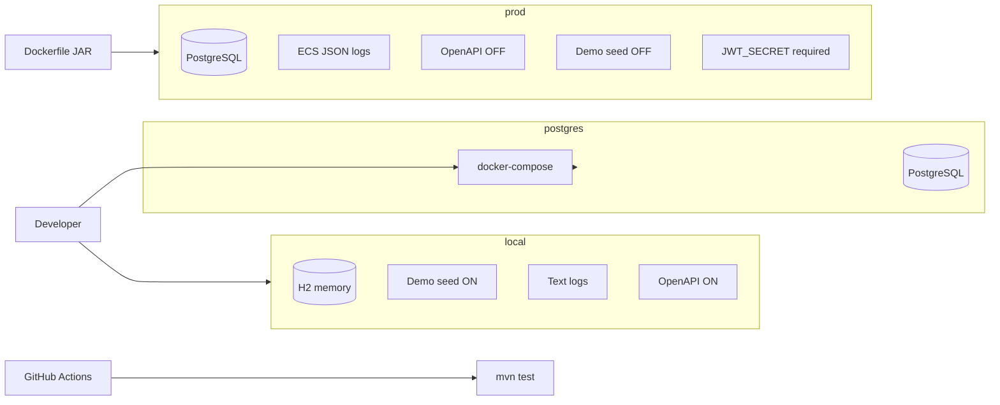

# Diagram: Deploy profiles

> **Living diagram** — update when profiles or deploy artifacts change.

## Artifacts

- `docker-compose.yml` — Postgres 16  
- `Dockerfile` — multi-stage Temurin 21  
- `.github/workflows/ci.yml` — Spotless + tests  
