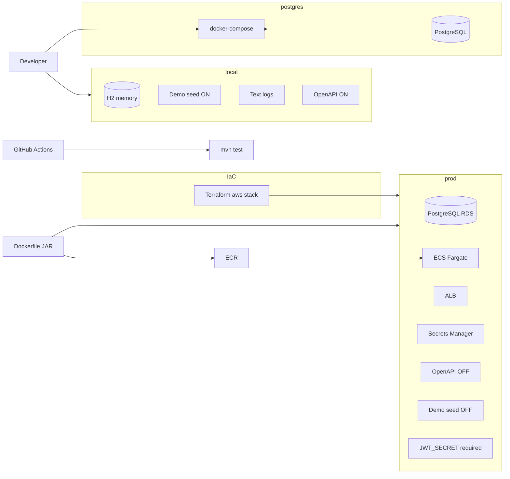

# Diagram: Deploy profiles

> **Living diagram** — update when profiles or deploy artifacts change.

## Artifacts

- `docker-compose.yml` — Postgres 16 (host 5433)  
- `Dockerfile` — multi-stage Temurin 21  
- `infra/terraform/aws/` — VPC, RDS, ECR, Secrets, ALB, ECS  
- `.github/workflows/ci.yml` — Spotless + SpotBugs + tests  

