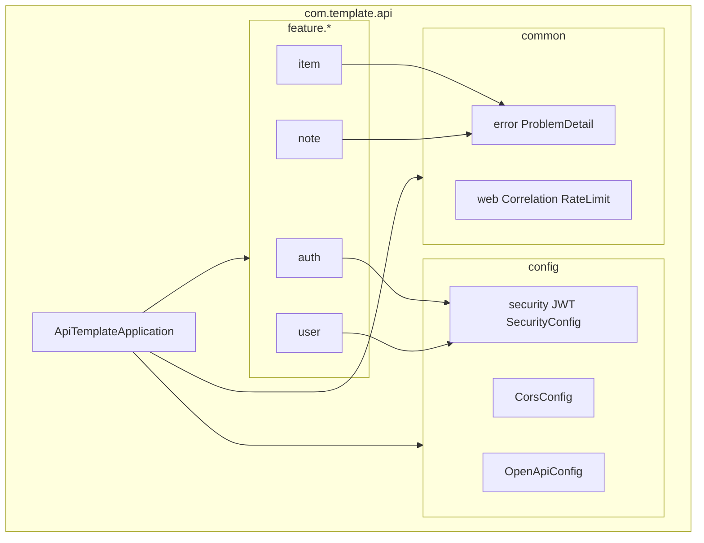

# Diagram: Package structure

> **Living diagram** — update when packages/features are added.  
> Full folder prose: [FOLDER-STRUCTURE.md](../FOLDER-STRUCTURE.md)



## Feature package contents (pattern)

```
feature.<name>/
  *Controller
  *Service
  *Repository
  * entity
  *Request / *Response
  *Mapper (MapStruct, optional)
```
