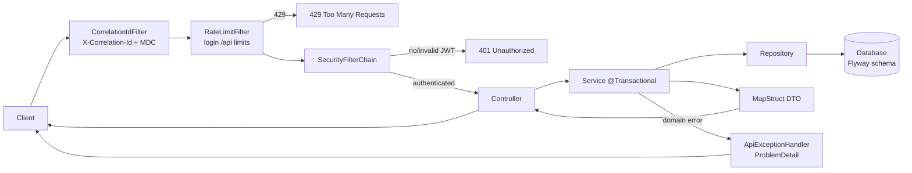

# Diagram: Request pipeline

> **Living diagram** — update when filters, security, or error handling change.

## Filter order (approx)

1. `CorrelationIdFilter` (highest precedence)  
2. `RateLimitFilter`  
3. Spring Security + `JwtAuthenticationFilter`  
4. DispatcherServlet → Controller  
